# HCI Lab + IA — modelo ER lógico v2.1

**Base de contraste:** HCI Lab + IA 2.5.0 desplegado, `main` en `c17011abe0c80486b910cc01785d2064a880d36e`, más las HU acordadas. La última publicación de Pages y `main` apuntan al mismo SHA. El almacenamiento persistente de aplicación exige una cuenta registrada y activa; visitantes usan el navegador y no generan filas en backend.

**Revisión de diseño:** esta versión incorpora el estado del servicio Identidad implementado en la iteración 3, añade el ciclo de tokens de un solo uso y aclara propiedad de datos entre servicios. Los originales compartidos se conservan; esta es la copia revisada.

**Total del modelo relacional consolidado: 55 tablas.** El conteo incluye las 54 tablas de la versión recibida más `TOKEN_CUENTA`. Este conteo representa el modelo lógico completo, no una única migración de producción: el DDL de referencia contiene relaciones entre dominios y debe descomponerse en migraciones con propiedad por servicio antes de desplegar servicios independientes.

## ER por dominios

```mermaid
erDiagram
  CUENTA ||--o{ CUENTA_ROL : tiene
  ROL ||--o{ CUENTA_ROL : asignado
  ROL ||--o{ ROL_PERMISO : concede
  PERMISO ||--o{ ROL_PERMISO : incluido
  CUENTA ||--o{ SESION_ACCESO : inicia
  CUENTA ||--o{ TOKEN_CUENTA : verifica_o_recupera
  CUENTA ||--o{ ESPACIO_TRABAJO : posee
  CUENTA ||--o{ MEMBRESIA_GRUPO : participa
  GRUPO ||--o{ MEMBRESIA_GRUPO : contiene
  GRUPO ||--o{ INVITACION_GRUPO : invita
  CUENTA ||--o{ INVITACION_GRUPO : crea
  MODULO ||--o{ ACTIVIDAD : contiene
  ACTIVIDAD ||--o{ ACTIVIDAD_VERSION : versiona
  ACTIVIDAD_VERSION ||--o{ DEFINICION_METRICA : define
  ESPACIO_TRABAJO ||--o{ ESPACIO_TRABAJO_GRUPO : comparte
  GRUPO ||--o{ ESPACIO_TRABAJO_GRUPO : recibe
  ESPACIO_TRABAJO ||--o{ EJECUCION_ACTIVIDAD : registra
  CUENTA ||--o{ EJECUCION_ACTIVIDAD : realiza
  ACTIVIDAD_VERSION ||--o{ EJECUCION_ACTIVIDAD : ejecutada
  ASIGNACION_ACTIVIDAD ||--o{ EJECUCION_ACTIVIDAD : contextualiza
  EJECUCION_ACTIVIDAD ||--o{ VALOR_METRICA : mide
  DEFINICION_METRICA ||--o{ VALOR_METRICA : tipa
  EJECUCION_ACTIVIDAD ||--o{ ENSAYO_EXPERIMENTO : contiene
  EJECUCION_ACTIVIDAD ||--o| RESULTADO_CONCEPTO : registra
  EJECUCION_ACTIVIDAD ||--o| OBSERVACION_PATRON : registra
  EJECUCION_ACTIVIDAD ||--o| REVISION_IA : registra
  EJECUCION_ACTIVIDAD ||--o| EVALUACION_CHATBOT : registra
  EJECUCION_ACTIVIDAD ||--o| EVIDENCIA_MULTIMODAL : registra
  GRUPO ||--o{ ASIGNACION_ACTIVIDAD : recibe
  ACTIVIDAD_VERSION ||--o{ ASIGNACION_ACTIVIDAD : asignada
  ASIGNACION_ACTIVIDAD ||--o{ CRITERIO_ASIGNACION : evalua
  CUENTA ||--o{ PERSONA : crea
  CUENTA ||--o{ ESCENARIO : crea
  PERSONA o|--o{ ESCENARIO : contextualiza
  CUENTA ||--o{ SESION_EVALUACION : participa
  INSTRUMENTO ||--o{ ITEM_INSTRUMENTO : contiene
  INSTRUMENTO ||--o{ SESION_EVALUACION : aplicado
  SESION_EVALUACION ||--o{ RESPUESTA_ITEM : recoge
  ITEM_INSTRUMENTO ||--o{ RESPUESTA_ITEM : respondido
  SESION_EVALUACION ||--o{ HALLAZGO_HEURISTICO : registra
  HEURISTICA_VERSION ||--o{ HALLAZGO_HEURISTICO : clasifica
  EJECUCION_ACTIVIDAD ||--o{ ENTREGA : produce
  ENTREGA ||--o{ VALORACION : recibe
  CRITERIO_ASIGNACION ||--o{ VALORACION : aplica
  ENTREGA ||--o{ RETROALIMENTACION : recibe
  CUENTA ||--o{ RETROALIMENTACION : escribe
  EJECUCION_ACTIVIDAD ||--o{ SESION_UX : instrumenta
  SESION_UX ||--o{ EVENTO_UX : captura
  SESION_UX ||--o{ SESION_UX_EXPOSICION : resume
  SESION_UX ||--o| VALIDACION_CALIBRACION : valida
  SESION_UX ||--o{ CONSENTIMIENTO : autoriza
  ESPACIO_TRABAJO ||--o{ VERIFICACION_ACCESIBILIDAD : registra
  ESPACIO_TRABAJO ||--o{ EVENTO_LABORATORIO : registra
  EJECUCION_ACTIVIDAD ||--o{ EVIDENCIA : adjunta
  ENTREGA ||--o{ ENTREGA_EVIDENCIA : contiene
  EVIDENCIA ||--o{ ENTREGA_EVIDENCIA : incluida
  CUENTA ||--o{ INFORME : solicita
  INFORME ||--o{ INFORME_REGISTRO : incluye
  EJECUCION_ACTIVIDAD o|--o{ INFORME_REGISTRO : fuente
  PERSONA o|--o{ INFORME_REGISTRO : fuente
  ESCENARIO o|--o{ INFORME_REGISTRO : fuente
  RESERVA o|--o{ INFORME_REGISTRO : fuente
  HALLAZGO_HEURISTICO o|--o{ INFORME_REGISTRO : fuente
  SESION_EVALUACION o|--o{ INFORME_REGISTRO : fuente
  SESION_UX o|--o{ INFORME_REGISTRO : fuente
  EVIDENCIA o|--o{ INFORME_REGISTRO : fuente
  EVIDENCIA_MULTIMODAL o|--o{ INFORME_REGISTRO : fuente
  USUARIO_DEMO o|--o{ INFORME_REGISTRO : fuente
  EVENTO_LABORATORIO o|--o{ INFORME_REGISTRO : fuente
  VERIFICACION_ACCESIBILIDAD o|--o{ INFORME_REGISTRO : fuente
  CUENTA ||--o{ SUGERENCIA : propone
  SUGERENCIA ||--o{ HISTORIAL_SUGERENCIA : cambia
  CUENTA ||--o{ USUARIO_DEMO : crea
  CUENTA ||--o{ RESERVA : crea
  ESPACIO_TRABAJO ||--o{ RESERVA : contiene
  SERVICIO_RESERVA o|--o{ RESERVA : identifica
  CUENTA ||--o| PREFERENCIA_CUENTA : configura
  CUENTA ||--o{ EVENTO_AUDITORIA : actor
```

## Tablas y atributos

Convenciones: `PK` clave primaria; `FK` clave foránea; `UQ` único; `NULL` opcional. Los tipos, restricciones y referencias exactas están en `02-ddl-postgresql.sql`.

### Identidad, permisos y espacios

- **CUENTA** (`cuenta_id` PK, `correo`, `correo_normalizado` UQ, `nombre`, `apellido` nullable, `hash_contrasena`, `estado`, `correo_verificado_en`, `creado_en`, `actualizado_en`, `desactivado_en`, `version_registro`). El correo normalizado es `lower(btrim(correo))`; `nombre` conserva el nombre visible recibido por el frontend actual y no se infiere un apellido.
- **ROL** (`rol_id` PK, `codigo` UQ, `nombre`, `descripcion`).
- **PERMISO** (`permiso_id` PK, `codigo` UQ, `descripcion`).
- **CUENTA_ROL** (`cuenta_id` PK/FK, `rol_id` PK/FK, `asignado_por` FK nullable, `asignado_en`).
- **ROL_PERMISO** (`rol_id` PK/FK, `permiso_id` PK/FK).
- **SESION_ACCESO** (`sesion_id` PK, `cuenta_id` FK, `token_hash` UQ, `csrf_hash`, `creada_en`, `ultimo_uso_en`, `expira_en`, `revocada_en`). No se almacena el token de sesión ni el token CSRF en claro.
- **TOKEN_CUENTA** (`token_id` PK, `cuenta_id` FK, `proposito` `verify_email/reset_password`, `token_hash` UQ, `expira_en`, `consumido_en`, `creado_en`). Es de un solo uso; la operación de consumo debe ser atómica y comprobar vencimiento.
- **ESPACIO_TRABAJO** (`espacio_id` PK, `propietario_id` FK, `nombre`, `creado_en`, `actualizado_en`, `archivado_en`). Solo cuentas registradas tienen espacio remoto.
- **ESPACIO_TRABAJO_GRUPO** (`espacio_id` PK/FK, `grupo_id` PK/FK, `compartido_por` FK, `compartido_en`, `revocado_en`). Da acceso explícito a un grupo; pertenecer al grupo por sí solo no expone el espacio.
- **GRUPO** (`grupo_id` PK, `nombre`, `descripcion`, `estado`, `creado_por` FK, `creado_en`, `actualizado_en`, `archivado_en`).
- **MEMBRESIA_GRUPO** (`grupo_id` PK/FK, `cuenta_id` PK/FK, `funcion`, `estado`, `invitado_por` FK nullable, `unido_en`, `retirado_en`). `funcion` es líder/profesor o participante dentro de ese grupo; no es un rol global ni concede permisos fuera de ese grupo.
- **INVITACION_GRUPO** (`invitacion_id` PK, `grupo_id` FK, `codigo_hash` UQ, `correo_destino` nullable, `creada_por` FK, `creada_en`, `expira_en`, `revocada_en`, `aceptada_por` FK nullable, `aceptada_en`).

### Catálogo versionado y asignaciones

- **MODULO** (`modulo_id` PK, `codigo` UQ, `nombre`, `descripcion`, `ruta`).
- **ACTIVIDAD** (`actividad_id` PK, `modulo_id` FK, `codigo`, `nombre`, `tipo`, `activa`, UQ(`modulo_id`,`codigo`)).
- **ACTIVIDAD_VERSION** (`actividad_version_id` PK, `actividad_id` FK, `numero_version`, `locale`, `titulo`, `descripcion`, `reglas_json`, `publicada_en`, UQ(`actividad_id`,`numero_version`,`locale`)). `reglas_json` solo guarda configuración versionada, no resultados ni valores consultables.
- **DEFINICION_METRICA** (`metrica_id` PK, `actividad_version_id` FK, `codigo`, `nombre`, `tipo_valor`, `unidad`, `minimo`, `maximo`, `formula`, `version_formula`, `derivada`, UQ(`actividad_version_id`,`codigo`)).
- **ASIGNACION_ACTIVIDAD** (`asignacion_id` PK, `grupo_id` FK, `actividad_version_id` FK, `creada_por` FK, `titulo`, `instrucciones`, `abre_en`, `vence_en`, `estado`, `creada_en`).
- **CRITERIO_ASIGNACION** (`criterio_id` PK, `asignacion_id` FK, `codigo`, `nombre`, `descripcion`, `puntaje_maximo`, `orden`, UQ(`asignacion_id`,`codigo`)).

### Trabajo, resultados y evaluaciones

- **EJECUCION_ACTIVIDAD** (`ejecucion_id` PK, `espacio_id` FK, `cuenta_id` FK, `actividad_version_id` FK, `asignacion_id` FK nullable, clave idempotencia opcional, `alias_participante`, `condicion`, `origen_dato`, `estado`, `iniciada_en`, `finalizada_en`, `notas`, `version_registro`). El `cuenta_id` obligatorio excluye visitantes.
- **VALOR_METRICA** (`valor_id` PK, `ejecucion_id` FK, `metrica_id` FK, `indice_repeticion`, `valor_numerico`, `valor_texto`, `valor_booleano`, `registrado_en`, UQ(`ejecucion_id`,`metrica_id`,`indice_repeticion`)). Solo una de las tres columnas valor puede tener dato.
- **ENSAYO_EXPERIMENTO** (`ensayo_id` PK, `ejecucion_id` FK, `numero`, `fase` práctica/medición, `segundos`, `errores`, `tipo_entrada`, `distancia_px`, `tamano_objetivo_px`, `numero_opciones`, `indice_dificultad`, UQ(`ejecucion_id`,`numero`)). Fitts usa distancia/tamaño; Hick usa número de opciones; CHECKs impiden combinaciones impropias.
- **RESULTADO_CONCEPTO** (`ejecucion_id` PK/FK, `concepto_codigo`, `resultado`, `texto_usuario`, `razon`, `edicion`, `decision`, emoción/confianza antes y después).
- **OBSERVACION_PATRON** (`ejecucion_id` PK/FK, `patron_codigo`, `problema`, `principio`, `correccion`).
- **REVISION_IA** (`ejecucion_id` PK/FK, `tipo`, `proveedor`, `modelo`, `prompt`, `propuesta`, `base`, `limites`, `revision_humana`, `razon_decision`, `decision`, `generada_en`). Credenciales nunca se guardan aquí.
- **EVALUACION_CHATBOT** (`ejecucion_id` PK/FK, `variante`, `prompt`, `respuesta`, `respuesta_humana`, claridad/control/tono/transparencia 1–5).
- **EVIDENCIA_MULTIMODAL** (`ejecucion_id` PK/FK, `dispositivo`, `practica`, `modo_visual`, `notas`, `confianza`, `estado_demo`, `estado_canal`).
- **PERSONA** (`persona_id` PK, `espacio_id` FK, `creada_por` FK, `nombre`, `edad_texto`, `contexto`, `objetivo`, `barrera`, `dispositivo`, `dice`, `piensa`, `hace`, `siente`, `base` observada/asumida/mixta, `observacion`, `supuestos`, `fuente_emocion`, `creada_en`, `actualizada_en`). Los cuatro campos de empatía son atómicos.
- **ESCENARIO** (`escenario_id` PK, `espacio_id` FK, `creado_por` FK, `persona_id` FK nullable, `titulo`, `actor`, `contexto`, `tarea`, `restriccion`, `criterio_exito`, `ficticio`, `creado_en`, `actualizado_en`).
- **INSTRUMENTO** (`instrumento_id` PK, `codigo`, `version`, `locale`, `nombre`, `tipo`, `formula_version`, UQ(`codigo`,`version`,`locale`)). SUS y NASA-TLX se versionan aquí.
- **ITEM_INSTRUMENTO** (`item_id` PK, `instrumento_id` FK, `codigo`, `enunciado`, `orden`, `minimo`, `maximo`, UQ(`instrumento_id`,`codigo`), UQ(`instrumento_id`,`orden`)).
- **SESION_EVALUACION** (`sesion_evaluacion_id` PK, `cuenta_id` FK, `espacio_id` FK, `ejecucion_id` FK nullable, `instrumento_id` FK nullable, `tipo`, `participante_alias`, `tarea`, `exito`, `segundos`, `errores`, `seq`, `emocion`, `notas`, `iniciada_en`, `finalizada_en`).
- **RESPUESTA_ITEM** (`respuesta_id` PK, `sesion_evaluacion_id` FK, `item_id` FK, `valor_numerico`, `valor_texto`, `respondida_en`, UQ(`sesion_evaluacion_id`,`item_id`)).
- **HEURISTICA_VERSION** (`heuristica_version_id` PK, `codigo`, `numero_version`, `locale`, `nombre`, `explicacion`, `pregunta`, `ejemplo`, UQ(`codigo`,`numero_version`,`locale`)). Diez heurísticas del catálogo actual se cargan como datos iniciales versionados.
- **HALLAZGO_HEURISTICO** (`hallazgo_id` PK, `espacio_id` FK, `sesion_evaluacion_id` FK nullable, `ejecucion_id` FK nullable, `creado_por` FK, `heuristica_version_id` FK opcional, `heuristica_etiqueta` obligatoria para preservar hallazgos históricos, `tarea`, `severidad` 0–4, `problema`, `evidencia`, `recomendacion`, `fuente` humana/IA, `estado` pendiente/validado/rechazado, `creado_en`).
- **ENTREGA** (`entrega_id` PK, `ejecucion_id` FK, `numero_version`, `estado`, `comentario_estudiante`, `enviada_en`, UQ(`ejecucion_id`,`numero_version`)).
- **VALORACION** (`valoracion_id` PK, `entrega_id` FK, `criterio_id` FK, `evaluada_por` FK, `puntaje`, `comentario`, `evaluada_en`, UQ(`entrega_id`,`criterio_id`,`evaluada_por`)).
- **RETROALIMENTACION** (`retroalimentacion_id` PK, `entrega_id` FK, `autor_id` FK, `respuesta_a` FK nullable, `mensaje`, `tipo`, `creada_en`).

### Seguimiento, evidencias, informes y comunidad

- **SESION_UX** (`sesion_ux_id` PK, `ejecucion_id` FK, `cuenta_id` FK, tipo page/example, ruta, participante, tarea, prototipo, destino, sistema de coordenadas, condición de ejemplo, modo/origen, dimensiones de página/ventana, duración, profundidad máxima, conteos de clic/rueda, error de validación, límite, fechas y notas).
- **EVENTO_UX** (`evento_ux_id` PK, `sesion_ux_id` FK, `canal`, `ocurrido_ms`, `x`, `y`, `peso`, `area`, `ruta`, `scroll_top_px`, `profundidad_pct`, `direccion`, `modo`, `origen_dato`). `canal`: clic, puntero, gaze, simulación, scroll, rueda o cambio de modo.
- **SESION_UX_EXPOSICION** (`sesion_ux_id` PK/FK, `banda` PK, `segundos`).
- **VALIDACION_CALIBRACION** (`sesion_ux_id` PK/FK, error mediano, dimensiones de ventana, muestras y fecha).
- **VERIFICACION_ACCESIBILIDAD** (`verificacion_accesibilidad_id` PK, `espacio_id` FK, `cuenta_id` FK, código de comprobación, resultado y fecha).
- **EVENTO_LABORATORIO** (`evento_laboratorio_id` PK, `espacio_id` FK, `cuenta_id` FK, tipo, fecha, duración y detalle). Separa telemetría funcional de la auditoría técnica.
- **CONSENTIMIENTO** (`consentimiento_id` PK, `sesion_ux_id` FK, `proposito`, `version_aviso`, `otorgado`, `registrado_en`, `revocado_en`).
- **EVIDENCIA** (`evidencia_id` PK, `ejecucion_id` FK, `creada_por` FK, `nombre`, `mime`, `bytes`, `sha256`, `ubicacion`, `creada_en`, `eliminada_en`). Archivo binario fuera de PostgreSQL.
- **ENTREGA_EVIDENCIA** (`entrega_id` PK/FK, `evidencia_id` PK/FK).
- **INFORME** (`informe_id` PK, `solicitado_por` FK, `espacio_id` FK, `grupo_id` nullable, `nombre_proyecto`, `objetivo`, `metodo`, `interpretacion`, `mejoras`, `limites`, `conclusiones`, `referencias`, `incluir_comparacion`, `justificacion`, `formato`, `creado_en`).
- **INFORME_REGISTRO** (`informe_registro_id` PK, `informe_id` FK, sección `selected/before/after`, orden y exactamente una FK de origen). Permite seleccionar las distintas colecciones que el informe actual exporta; las métricas se calculan desde la fuente.
- **SUGERENCIA** (`sugerencia_id` PK, `autor_id` FK obligatorio, `categoria`, `titulo`, `descripcion`, `anonima`, `estado`, `creada_en`). Solo cuentas registradas crean sugerencias; `anonima` oculta la atribución en la vista de moderación, sin perder trazabilidad autorizada.
- **HISTORIAL_SUGERENCIA** (`historial_id` PK, `sugerencia_id` FK, `cambiado_por` FK nullable, `estado_anterior`, `estado_nuevo`, `respuesta`, `cambiado_en`).

### Datos didácticos y preferencias

- **USUARIO_DEMO** (`usuario_demo_id` PK, `creado_por` FK, `nombre`, `correo_demo`, `rol_demo`, `estado`, `creado_en`, `actualizado_en`). CRUD ficticio; separado de `CUENTA`.
- **SERVICIO_RESERVA** (`servicio_codigo` PK, contexto, activo) con códigos del catálogo vigente.
- **RESERVA** (`reserva_id` PK, `espacio_id` FK, `creada_por` FK, `servicio_codigo` nullable, etiqueta del servicio, fecha/hora local, estado, condición y fechas). Preserva citas históricas con servicio libre; no vincula la reserva a un usuario ficticio ni inventa recursos físicos.
- **PREFERENCIA_CUENTA** (`cuenta_id` PK/FK, `idioma`, `tema_oscuro`, `alto_contraste`, `tamano_fuente_pct`, `espaciado`, `fuente_dislexia`, `movimiento_reducido`, `actualizada_en`).
- **EVENTO_AUDITORIA** (`evento_auditoria_id` PK, `actor_id` FK obligatorio, `tipo`, `recurso_tipo`, `recurso_id`, `resultado`, `ocurrido_en`, `correlation_id`). No guardar contraseñas, tokens ni datos sensibles en el detalle.

## Reglas de normalización

1FN: valores atómicos y eventos/ensayos/respuestas en filas separadas. 2FN: los atributos de las tablas de asociación dependen de toda su clave compuesta. 3FN/BCNF: catálogos y atributos descriptivos no se repiten en ejecuciones; cada determinante declarado es clave candidata. 4FN: roles-permisos, grupo-cuenta y entrega-evidencia se separan. 5FN: no se propone descomposición adicional sin una dependencia de unión no trivial; en el DDL deben verificarse estas dependencias junto con las reglas de negocio definitivas. Las claves únicas e índices no prueban 5FN por sí solos.

## Reglas de persistencia

- `EJECUCION_ACTIVIDAD.cuenta_id` y `espacio_id` obligatorios: **ningún visitante se registra como trabajo remoto**.
- Visitante: modo local del frontend; no guarda trabajo ni telemetría en API. Cuenta registrada: sincronización explícita.
- El consentimiento se requiere para seguimiento UX remoto; almacenar eventos solo mientras la política de retención lo permita. No se guarda video.
- La versión de actividad, instrumento, métrica y fórmula usada queda ligada al resultado histórico. Cada ejecución puede repetirse; la clave de idempotencia solo evita duplicar el mismo envío técnico. Se permiten múltiples ejecuciones de una misma actividad.
- Las reservas y usuarios ficticios no son cuentas ni se usan para autenticación.
- Todas las filas de trabajo, preferencias, sesiones UX, auditoría atribuible y sugerencias exigen `cuenta_id`/`autor_id` FK. La sugerencia anónima solo oculta la atribución en la vista de moderación; la autoría sigue protegida en la base. No existe modo de inserción para visitantes.

## Validación contra la versión desplegada

Se contrastó contra `src/features/project/domain/state.ts`, `evidence.ts`, `backup.ts`, `preferences.ts` y los dominios `users`, `reservations`, `research`, `evaluation`, `experiments`, `tracking`, `concepts`, `patterns`, `multimodal` y `reports`. La reserva conserva código opcional y etiqueta de servicio; hallazgos conservan etiqueta de heurística aunque falte el identificador; informes seleccionan registros de múltiples colecciones; seguimiento diferencia sesiones de página y de ejemplo, incluyendo coordenadas, exposición, modos y calibración.

**Visitantes:** API sin cuenta autenticada no ofrece endpoints de escritura para trabajo, reservas, sugerencias, preferencias ni telemetría. Todas las tablas operacionales tienen FK obligatoria a cuenta y, donde aplica, espacio de trabajo. `SUGERENCIA.autor_id` es obligatorio. Los procesos internos pueden dejar actor nulo únicamente en auditoría/historial, sin representar datos de visitantes. Las demos públicas continúan ejecutándose localmente.

**Limitaciones:** el DDL no se ha ejecutado contra un servidor PostgreSQL en este entorno. Las reglas cruzadas (propietario del espacio, pertenencia y rol activo, correspondencia de versión/definición de métrica y pertenencia del criterio a la asignación) deben validarse en casos de uso transaccionales y pruebas de integración; están indicadas al final del SQL.

## Revisión v2.1: identidad y límites de servicio

### Cuentas, roles y tokens

- `ROL` y `PERMISO` son globales a la plataforma; solo las relaciones `CUENTA_ROL` y `ROL_PERMISO` otorgan permisos globales. Los códigos iniciales `administrator`, `participant`, `teacher` y `evaluator` no se deben tratar como jerarquía: `teacher` y `evaluator` no implican `administrator`.
- `MEMBRESIA_GRUPO.funcion` es independiente del rol global. Una función `leader` solo autoriza operaciones sobre ese grupo y requiere membresía activa. Tener el rol global `teacher` tampoco crea membresía ni acceso a los datos del grupo.
- Las altas asignan `participant` en la misma transacción que crea la cuenta. La asignación de `administrator` requiere permiso global explícito y actor autorizado; el servidor no acepta que el cliente se autoasigne roles.
- La verificación cambia una cuenta `pending` a `active`. `inactive` representa desactivación y debe revocar sus sesiones; `locked` bloquea el acceso temporal o administrativamente. `desactivado_en` corresponde a `inactive`. Cuenta activa requiere correo verificado.
- `TOKEN_CUENTA` formaliza la tabla de un solo uso que ya usa el servicio actual (`identity.one_time_tokens`). Solo guarda el hash. La aplicación consume con una actualización condicional (`consumido_en IS NULL AND expira_en > now()`) dentro de una transacción; exactamente una solicitud concurrente puede tener éxito.
- El servicio de Identidad actual usa cookies `HttpOnly`, hash de sesión y protección CSRF. `csrf_hash` y `ultimo_uso_en` se incorporan al modelo de sesión para documentar ese comportamiento.
- El frontend y la API actual intercambian `display_name`; el almacenamiento del MER usa `nombre` para el nombre visible y deja `apellido` opcional. La migración debe trasladar el valor existente a `nombre` sin dividirlo ni inferir datos personales.

### Propiedad de datos y referencias

El ER completo conserva las relaciones de negocio para lectura y revisión. En la ejecución, cada servicio es dueño de sus tablas y sus restricciones locales:

| Servicio propietario | Entidades principales |
| --- | --- |
| Identidad | `CUENTA`, `ROL`, `PERMISO`, `CUENTA_ROL`, `ROL_PERMISO`, `SESION_ACCESO`, `TOKEN_CUENTA`, `PREFERENCIA_CUENTA` |
| Comunidad | `GRUPO`, `MEMBRESIA_GRUPO`, `INVITACION_GRUPO`, `SUGERENCIA`, `HISTORIAL_SUGERENCIA`, `SERVICIO_RESERVA`, `RESERVA` |
| Aprendizaje | `ESPACIO_TRABAJO`, `MODULO`, `ACTIVIDAD`, `ACTIVIDAD_VERSION`, `DEFINICION_METRICA`, asignaciones, ejecuciones, resultados, personas, escenarios, evaluaciones, entregas, valoraciones, retroalimentación y `USUARIO_DEMO` |
| Evidencias | sesiones/eventos UX, consentimiento, calibración, accesibilidad, evidencia, vínculos de evidencia e informes con sus fuentes seleccionadas |

La tabla `EVENTO_AUDITORIA` representa auditoría propia de cada servicio; no es una tabla compartida para consultas entre servicios. En los esquemas físicos, un ID que referencia otra propiedad es una referencia externa opaca y no una clave foránea a la base ajena. Cada propietario valida sus propios datos y ofrece contratos para las operaciones permitidas.

El DDL consolidado conserva las relaciones lógicas; las migraciones físicas mantienen restricciones solo dentro de cada servicio y las referencias externas se validan por contrato. Actualmente los flujos entre servicios son síncronos y fallan cerrados. No se usan transacciones distribuidas y todavía no se implementan outbox/inbox ni proyecciones asíncronas; deben añadirse antes de requerir consistencia eventual.

### Estados, eliminación y preservación

- Una ejecución puede estar `in_progress`, `completed` o `cancelled`; `completed` significa que la práctica terminó, no que el aprendizaje haya sido evaluado. Evaluaciones, respuestas, valoración y retroalimentación son registros separados.
- `ENTREGA` es versionada por ejecución; una nueva entrega agrega `numero_version` y no reemplaza el historial. Evidencia es metadato de archivo externo, y su vínculo a una entrega es explícito.
- La eliminación física de una cuenta no es la operación normal: se desactiva y se revocan sesiones/tokens. El DDL usa `RESTRICT` en datos de trabajo para proteger historial; `CASCADE` se reserva para componentes propiedad del padre (por ejemplo, sesión y tokens al eliminar físicamente una cuenta, o hijos de una ejecución cuando se apruebe esa retención).
- Grupos y espacios se archivan; no se borran en cascada entregas, valoraciones ni auditoría. La eliminación del binario de evidencia requiere marcar `eliminada_en` y aplicar la política de retención del almacenamiento. Plazos, anonimización y derecho de eliminación siguen pendientes de decisión institucional.
- El respaldo exportado por el frontend continúa siendo compatible y local. La sincronización hacia cuenta es explícita, valida versión y propiedad, y no convierte registros de `USUARIO_DEMO` en cuentas.
- La telemetría detallada (`EVENTO_UX`) no se captura ni envía por defecto. Su persistencia remota requiere opción informada por sesión y finalidad, retención definida y controles de borrado; no se almacena video de cámara.

### Flujo de extremo a extremo

Flujo objetivo: visitante explora en local → crea cuenta y verifica correo → sincroniza trabajo en su espacio → se une a grupo y comparte espacio explícitamente → trabaja sobre una asignación con entregas versionadas → profesor/evaluador autorizado deja valoración y retroalimentación → Evidencias genera informe desde fuentes autorizadas. La implementación disponible cubre partes de este flujo; sincronización de respaldos, compartir espacios, generación de archivo y proyección asíncrona siguen pendientes. Consultar la matriz de implementación.

## Estado de validación del MER v2.1

El DDL consolidado permanece como referencia lógica y no se ejecuta como una base única porque documenta claves foráneas entre propietarios. Las entidades se descompusieron en migraciones por servicio y se verificaron en PostgreSQL con pruebas de integración. Identidad 003 conserva datos previos y migra roles; Aprendizaje 003 añade idempotencia a las entregas. Las migraciones nuevas se aplicaron a las bases locales ya existentes y CI las ejecuta en PostgreSQL temporal.

### Pendientes

- Completar y probar casos de uso para todas las entidades del MER; la matriz de cobertura está en ../implementacion-mer-v2.1.md.
- Revisar reglas institucionales de retención, anonimización y eliminación. No se fijaron plazos.
- El catálogo de actividades requiere seeds revisados y traducidos a los seis idiomas.
- El DDL consolidado no se validó como una única instalación física: esa forma no corresponde a los cuatro límites de servicio.